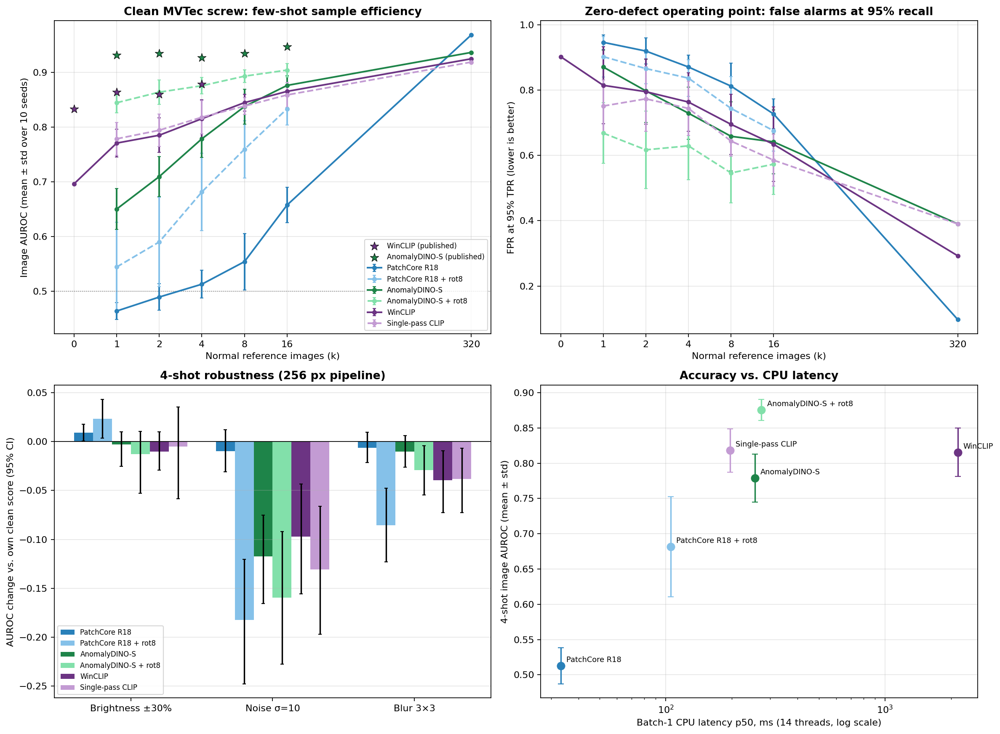
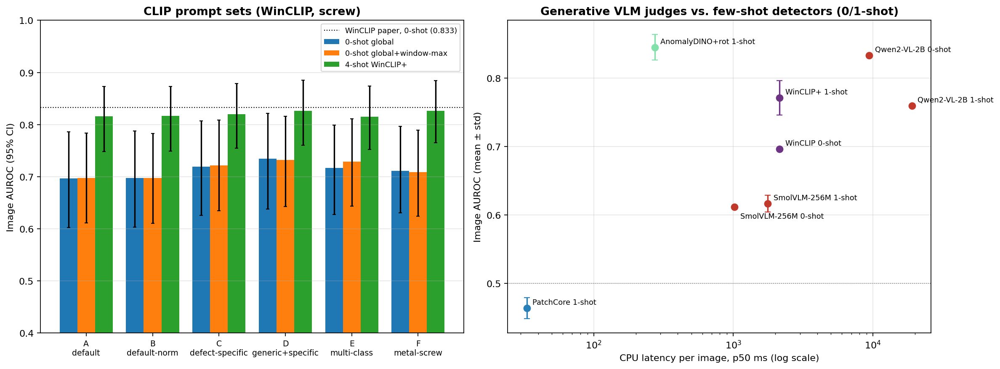

# VLMs & Foundation Models for Industrial AOI: Few-Shot Detection, Robustness & CPU Efficiency

An evaluation of how vision-language models, foundation models and conventional anomaly detectors perform under three constraints of real inspection lines: very little training data, changing image quality, and CPU-only deployment.

**The problem.** A new automated optical inspection (AOI) line may have only a handful of images of good parts, must find small defects, and can degrade when lighting or sensors change.

**What I did.** I compared six models (PatchCore, PaDiM, AnomalyDINO, WinCLIP, Qwen2-VL, SmolVLM) on the MVTec AD `screw` category, measured where they fail using paired statistical tests, optimized inference for CPU, and traced a gap against a published paper to a bug in a third-party library.

## Key Results

| Result | Evidence | Setting |
|:---|:---|:---|
| **Detection from one good image** | 0.845 image AUROC, vs. 0.544 for PatchCore with the same augmentation (0.464 without) | AnomalyDINO-S + rotation augmentation, 448 px, mean of 10 reference draws |
| **Detection with no training images** | 0.833 image AUROC, vs. 0.697 for WinCLIP (+0.136, 95% CI [+0.014, +0.251]) | Qwen2-VL-2B, scored by its Yes/No probability, 9.4 s per image at 14 threads |
| **Full data still wins** | PatchCore 0.969 with 320 images; best 16-image model 0.904 (-0.064, 95% CI [-0.125, -0.010]) | No coreset pruning, paired test on the 160 test images |
| **7.5× faster CPU inference** | 331 ms → 44 ms (23 FPS) for a 0.018 AUROC drop; memory bank 25× smaller | PatchCore coreset 0.25 → 0.01, 256 px, batch 1, 4 threads |
| **Library bug found and fixed** | Zero-shot localization 0.586 → 0.914 pixel AUROC (paper: ~0.90) | anomalib 2.7.0 + open_clip_torch 3.3.0, [reproducer included](scripts/repro_winclip_window_bug.py) |

These numbers come from separate experiments, so they are not one directly comparable benchmark. Test hardware: Intel Core Ultra 5 125H, 16 GB RAM, no GPU.





## What I Built

- **Few-shot benchmark.** Every model scores against the same 10 random reference draws for 0–16 images, plus a full-data run. Each image is encoded once and its features cached, and a self-check confirms the cached scores match anomalib's own output.
- **VLM anomaly judge.** A single forward pass turns a yes/no question into a continuous score, the log-odds of "Yes" vs. "No", so AUROC needs no threshold.
- **Statistical evaluation.** Paired bootstrap confidence intervals, multi-seed spread, per-defect analysis, and a held-out split for threshold calibration.
- **CPU optimization.** Memory-bank pruning, per-stage latency profiling, and ONNX Runtime export of the backbone, with embedding parity checked against PyTorch.
- **Library debugging.** Found that anomalib's WinCLIP gave all 365 window crops the same embedding because of a tensor-layout mismatch with OpenCLIP, then wrote a patch and a [minimal reproducer](scripts/repro_winclip_window_bug.py).

## Key Insights

- **Rotation coverage explains much of PatchCore's few-shot failure.** Screws appear at random angles. Adding rotated references gained PatchCore +0.17 AUROC at 4 images and +0.18 at 16.
- **Foundation models are a cold-start tool, not a replacement.** They work from the first image, but PatchCore wins once a full training set exists.
- **A VLM's ranking is useful; its literal answers are not.** Qwen2-VL said "Yes" to only 6% of defective screws, and showing it a good reference image lowered its AUROC to 0.760.
- **Prompt wording was not a useful lever.** No prompt set significantly beat the default, and prompts naming specific defects cut zero-shot localization from 0.91 to 0.37–0.63.
- **Sensor noise is the bigger risk.** Noise at σ=10 cost full-data PatchCore 0.27 AUROC. For brightness, the first significant drop appeared at ±40%; at ±30% no drop was detected, which is not proof that ±30% is safe.
- **Speeding up the backbone alone has limited value.** ONNX Runtime made the backbone 2.1× faster, but the full pipeline only 1.31× (47 → 36 ms) at coreset 0.01, and 1.10× at coreset 0.10, where kNN search dominates.

## Limitations

- Only one MVTec AD category (`screw`) was tested, so results may not carry over to other products.
- Latency was measured on a laptop CPU, not on embedded hardware.
- My reproductions score below the papers on image-level detection: WinCLIP 0.70 vs. 0.83 at zero-shot, and AnomalyDINO 0.84 vs. 0.93 at one-shot (I used 448 px; the paper's table uses 672 px). The WinCLIP gap is unexplained.
- Qwen2-VL's one-shot result uses a single reference draw because of its CPU cost, and only one question wording was tested.

## Quick Start

```bash
pip install -r requirements.txt
```

Reproduce the library bug. This needs no dataset, only the CLIP weights that download on first run:

```bash
python scripts/repro_winclip_window_bug.py
```

Run the few-shot benchmark with MVTec AD at `data/mvtec` (about 50 minutes on CPU):

```bash
python notebooks/09_foundation_models_fewshot.py
```

Commands for every experiment are in the [technical report](results/TECHNICAL_REPORT.md#7-setup--reproducible-execution).

## Detailed Results

- **[Technical report](results/TECHNICAL_REPORT.md):** environment, robustness tables, PatchCore vs. PaDiM, per-defect analysis, CPU and ONNX profiling, few-shot and VLM results, and the repository structure.
- **[Few-shot and VLM write-up](results/foundation_fewshot/RESULTS.md):** all model tables, comparison with published numbers, and details of the WinCLIP bug.

## Author

**Sai Akash Agasthiraju Seshachalam**  
M.Sc. Autonomy Technologies, FAU Erlangen-Nürnberg  
[GitHub Profile](https://github.com/sai-akash)
