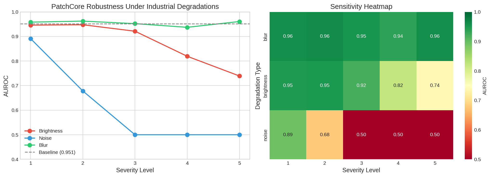
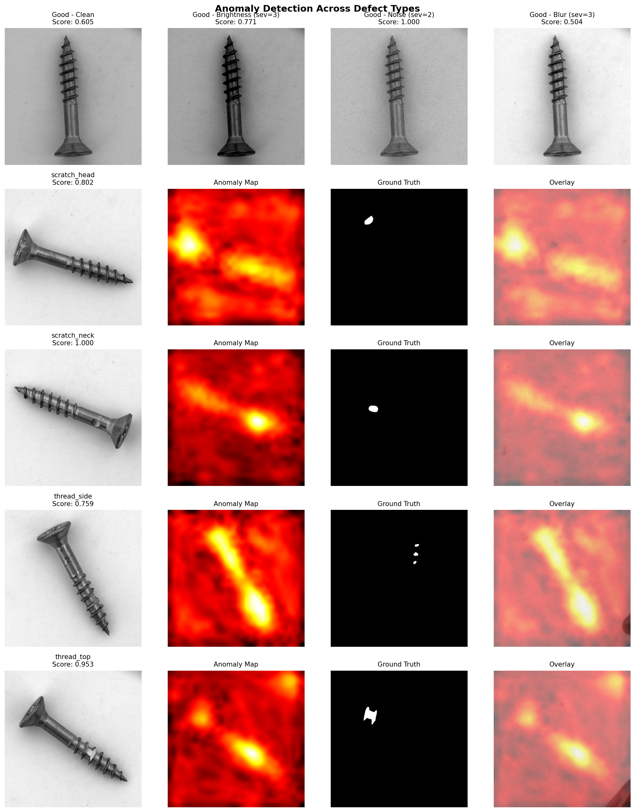

# Industrial AOI Robustness Analysis

Systematic evaluation of anomaly detection robustness under realistic industrial conditions for automated optical inspection (AOI) systems.

## Key Findings



**PatchCore is highly sensitive to sensor noise but robust to blur and moderate lighting changes.**

### Deployment Thresholds (AUROC > 0.90)

| Degradation | Safe Severity | Recommendation |
|-------------|---------------|----------------|
| Brightness | Up to level 3 | Control lighting within ±30% variation |
| Noise | ⚠️ None | Implement denoising preprocessing |
| Blur | Up to level 5 | Standard optics acceptable |

## Detection Across Defect Types



The model successfully detects and localizes multiple defect types:
- **scratch_head**: Localized on screw head (score: 0.802)
- **scratch_neck**: Strong detection (score: 1.000)
- **thread_side**: Thread damage detected (score: 0.759)
- **thread_top**: Strong detection (score: 0.953)

### Critical Finding: Noise Sensitivity

Under noise conditions, good samples receive anomaly score of 1.0 (same as defects), making classification impossible. This confirms the quantitative AUROC drop to 0.50.

## Results Summary

- **Baseline AUROC**: 0.951
- **Blur**: Maintains >0.92 AUROC across all severity levels
- **Brightness**: Degrades gracefully, drops below 0.90 at severity 4+
- **Noise**: Drops to random chance (0.50) at severity 3+

## Performance Benchmarks

| Metric | Value |
|--------|-------|
| Average inference time | 141.3 ms/image |
| Throughput | 7.1 images/sec |
| Real-time capable (>30 fps) | No |

**Note**: Benchmarked on CPU. For production deployment, GPU inference or lighter models like EfficientAD would improve throughput.

## Project Structure
```
industrial-aoi-robustness/
├── src/
│   └── augmentations.py          # Severity-based industrial degradations
├── notebooks/
│   ├── 01_baseline.py            # Model training
│   ├── 02_test_augmentations.ipynb
│   ├── 03_robustness_eval.py     # Core evaluation loop
│   ├── 04_visualize_results.py   # Analysis and plots
│   └── 05_detection_demo.py      # Qualitative detection demo
├── results/
│   ├── robustness_results.csv
│   ├── robustness_analysis.png
│   |── detection_demo_full.png
|   └── Patchcore 
├── checkpoints/
│   └── patchcore_screw.pt
└── data/
    └── mvtec/screw/
```

## Methodology

1. **Model**: PatchCore with ResNet18 backbone trained on MVTec AD (screw category)
2. **Degradations**: Simulated industrial conditions
   - Brightness: Lighting variation (±10% to ±50%)
   - Noise: Sensor noise (σ=10 to σ=50)
   - Blur: Focus drift (kernel 3x3 to 11x11)
3. **Evaluation**: AUROC measured at 5 severity levels per degradation

## Technologies

- PyTorch
- Anomalib
- Albumentations
- scikit-learn
- Matplotlib / Seaborn

## Future Work

- Implement denoising preprocessing to improve noise robustness
- Compare with other models (EfficientAD, FastFlow)
- Test on additional MVTec categories
- Validate methodology across additional MVTec categories (metal_nut, bottle, pill)

## Author

Sai Akash - M.Sc. Autonomy Technologies, FAU Erlangen-Nürnberg

## References

- [MVTec AD Dataset](https://www.mvtec.com/company/research/datasets/mvtec-ad)
- [PatchCore Paper](https://arxiv.org/abs/2106.08265)
- [Anomalib Library](https://github.com/openvinotoolkit/anomalib)