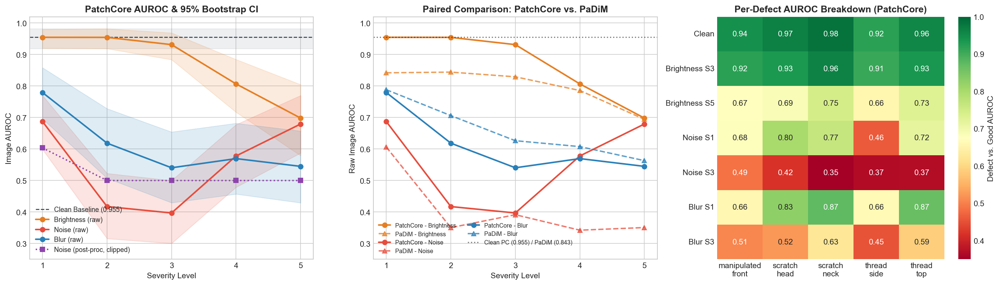
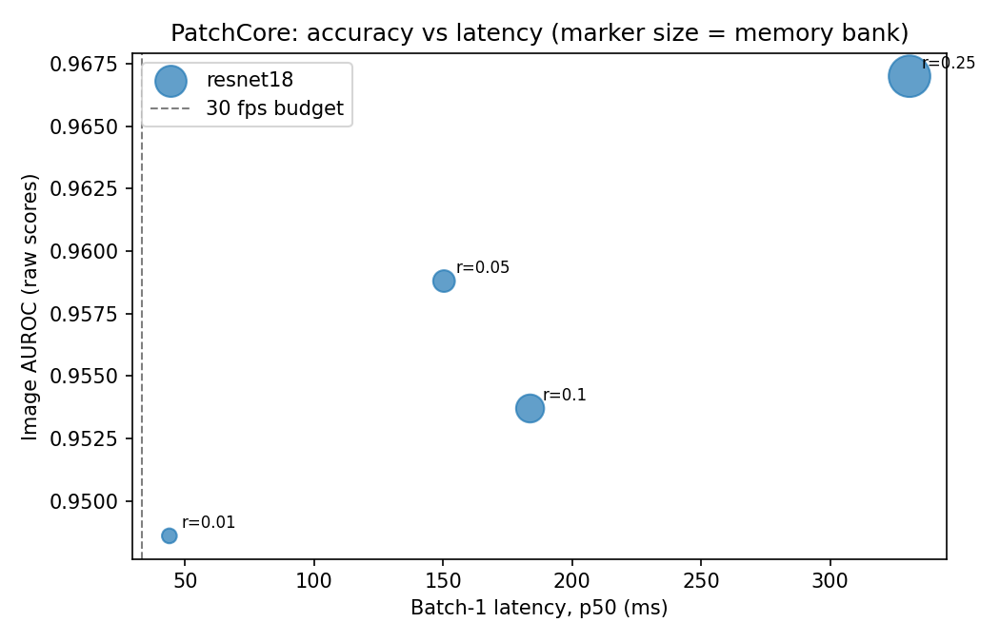
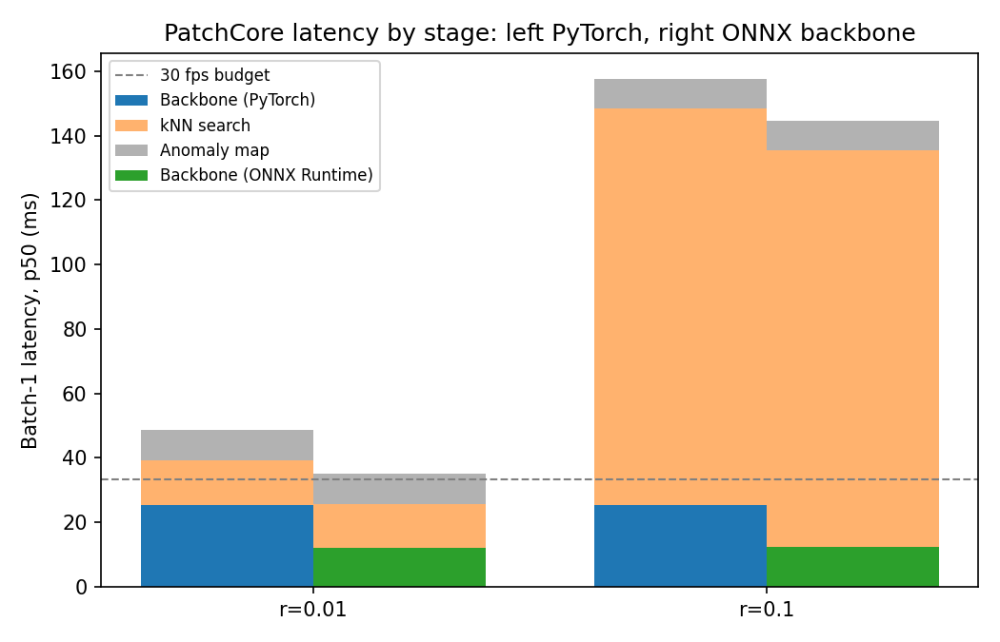

# Industrial AOI Robustness & Inference Efficiency Benchmark

Quantitative evaluation of anomaly detection robustness under realistic optical conditions, statistical confidence intervals and paired model comparisons, and CPU inference efficiency for automated optical inspection (AOI) systems.

---

## 1. Statistical Robustness & Failure Mode Analysis (P0 / P1 / P2)



We evaluated **PatchCore** (`resnet18`, `layer2+layer3`, coreset $r=0.01$) and **PaDiM** (`resnet18`, `layer1+layer2+layer3`) on the MVTec AD `screw` test set ($N = 160$ unique images: $41$ normal `good` and $119$ defective across $5$ defect categories) across $16$ optical conditions (clean + $3$ degradations $\times$ $5$ severities) and $3$ deterministic random seeds (`0, 1, 2`).
- **Paired Bootstrap CIs**: For each condition, we draw $2{,}000$ paired bootstrap resamples of the $N=160$ test images (using identical resampled image indices for clean and degraded conditions, and for PatchCore vs. PaDiM) to compute $95\%$ percentile confidence intervals on $\text{AUROC}$, $\Delta\text{AUROC}_{\text{cond}-\text{clean}}$, and $\Delta\text{AUROC}_{\text{PatchCore}-\text{PaDiM}}$.
- **Specimen Independence Note**: MVTec AD does not provide physical specimen IDs for `screw`, so each test image is treated as the resampling unit.

### 1.1 PatchCore Paired Bootstrap 95% CIs (`seed=0`) & Multi-Seed Stability (`seeds=0,1,2`)

| Condition | Sev. | Raw AUROC (95% CI) | Paired $\Delta$ vs. Clean (95% CI) | Stat. Sig. Drop? | Post-Proc. AUROC (95% CI) | Clipped at 1.0 | 3-Seed Mean $\pm$ SD |
|:---|:---:|:---:|:---:|:---:|:---:|:---:|:---:|
| **Clean** | 0 | **0.9549** `[0.9183, 0.9810]` | `0.0000` | — | 0.9549 `[0.9183, 0.9810]` | 7.5% | $0.9549$ *(det.)* |
| **Brightness** ($\pm 10\%$) | 1 | 0.9547 `[0.9202, 0.9802]` | `-0.0002 [-0.0069, +0.0064]` | No | 0.9547 `[0.9202, 0.9802]` | 7.5% | $0.9569 \pm 0.0019$ |
| **Brightness** ($\pm 20\%$) | 2 | 0.9545 `[0.9188, 0.9820]` | `-0.0004 [-0.0123, +0.0111]` | No | 0.9545 `[0.9188, 0.9820]` | 7.5% | $0.9510 \pm 0.0081$ |
| **Brightness** ($\pm 30\%$) | 3 | **0.9315** `[0.8838, 0.9687]` | **`-0.0234 [-0.0689, +0.0144]`** | **No** | 0.9315 `[0.8838, 0.9687]` | 12.5% | $0.9268 \pm 0.0042$ |
| **Brightness** ($\pm 40\%$) | 4 | 0.8067 `[0.7169, 0.8844]` | `-0.1482 [-0.2433, -0.0638]` | **Yes** | 0.7940 `[0.7012, 0.8773]` | 30.0% | $0.7605 \pm 0.0412$ |
| **Brightness** ($\pm 50\%$) | 5 | 0.6983 `[0.5791, 0.8047]` | `-0.2566 [-0.3753, -0.1531]` | **Yes** | 0.6942 `[0.5754, 0.7995]` | 39.4% | $0.6965 \pm 0.0118$ |
| **Noise** ($\sigma=10$) | 1 | 0.6872 `[0.5988, 0.7700]` | `-0.2677 [-0.3582, -0.1815]` | **Yes** | 0.6036 `[0.5130, 0.6966]` | 66.3% | $0.6520 \pm 0.0364$ |
| **Noise** ($\sigma=20$) | 2 | 0.4173 `[0.3157, 0.5226]` | `-0.5376 [-0.6412, -0.4310]` | **Yes** | **0.5000 `[0.5000, 0.5000]`** | **100.0%** | $0.3950 \pm 0.0326$ |
| **Noise** ($\sigma=30$) | 3 | 0.3970 `[0.3004, 0.5000]` | `-0.5579 [-0.6570, -0.4498]` | **Yes** | **0.5000 `[0.5000, 0.5000]`** | **100.0%** | $0.4375 \pm 0.0409$ |
| **Noise** ($\sigma=40$) | 4 | 0.5780 `[0.4789, 0.6775]` | `-0.3769 [-0.4808, -0.2722]` | **Yes** | **0.5000 `[0.5000, 0.5000]`** | **100.0%** | $0.5503 \pm 0.0307$ |
| **Noise** ($\sigma=50$) | 5 | 0.6794 `[0.5874, 0.7700]` | `-0.2755 [-0.3735, -0.1738]` | **Yes** | **0.5000 `[0.5000, 0.5000]`** | **100.0%** | $0.6379 \pm 0.0533$ |
| **Blur** ($3\times 3$) | 1 | 0.7793 `[0.6958, 0.8582]` | `-0.1757 [-0.2565, -0.1002]` | **Yes** | 0.7793 `[0.6958, 0.8582]` | 13.1% | $0.7793$ *(det.)* |
| **Blur** ($5\times 5$) | 2 | 0.6186 `[0.5075, 0.7283]` | `-0.3363 [-0.4471, -0.2249]` | **Yes** | 0.6460 `[0.5470, 0.7401]` | 54.4% | $0.6186$ *(det.)* |
| **Blur** ($7\times 7$) | 3 | 0.5405 `[0.4296, 0.6542]` | `-0.4144 [-0.5280, -0.2964]` | **Yes** | 0.5202 `[0.4917, 0.5587]` | 98.1% | $0.5405$ *(det.)* |
| **Blur** ($9\times 9$) | 4 | 0.5696 `[0.4571, 0.6819]` | `-0.3853 [-0.5019, -0.2682]` | **Yes** | 0.5000 `[0.5000, 0.5000]` | 100.0% | $0.5696$ *(det.)* |
| **Blur** ($11\times 11$) | 5 | 0.5450 `[0.4294, 0.6571]` | `-0.4099 [-0.5262, -0.2929]` | **Yes** | 0.5000 `[0.5000, 0.5000]` | 100.0% | $0.5450$ *(det.)* |

* **Why Post-Processed Noise AUROC Was Exactly 0.500 vs. Raw AUROC $\le 0.42$**: Anomalib's default `PostProcessor` applies min–max normalization calibrated on clean images ($\text{threshold}=11.13$, $\min=10.00$, $\max=16.70$) and clamps normalized outputs to $[0, 1]$. Any raw patch distance $\ge 14.48$ saturates at $1.0$. Under Gaussian noise $\sigma \ge 20$ (severities 2–5), $100\%$ of images (`good` and defective alike) produce raw distances $\ge 15.83$, clamping every post-processed score to $1.0$ (`AUROC = 0.5000`, CI `[0.50, 0.50]`) while raw pre-clipping distances yield $\text{AUROC} = 0.4173$ (sev 2) and $0.3970$ (sev 3).
* **Statistically Grounded Operating Limit**: Up to Brightness Severity 3 ($\pm 30\%$), the paired difference $\Delta\text{AUROC} = -0.0234$ (`95% CI: [-0.0689, +0.0144]`) includes zero. At Severity 4 ($\pm 40\%$), the drop becomes statistically significant ($\Delta = -0.1482$, `95% CI: [-0.2433, -0.0638]`), confirming $\pm 30\%$ as the safe illumination operating boundary.
* **Resolution vs. Kernel Scale Note (`256×256` vs. `1024×1024`)**: In `08_robustness_stats.py` and `06_efficiency_benchmark.py`, degradations are applied at the model's $256\times 256$ input resolution, where $3\times 3$–$11\times 11$ blur kernels directly smooth fine screw threads (`AUROC: 0.779 -> 0.545`). In `03_robustness_eval.py`, applying the same pixel-kernel sizes to native $1024\times 1024$ images prior to $4\times$ antialiased downsampling yields an effective blur $\sigma_{\text{eff}} \le 0.5\text{ px}$ at $256\times 256$, which is absorbed by downsampling.

---

### 1.2 Paired Model Comparison: PatchCore vs. PaDiM (P2)

Both models were trained on the same MVTec AD `screw` training set (`resnet18` backbone) and evaluated on the exact same degraded image realizations (`seed=0`, $2{,}000$ paired bootstrap resamples):

| Condition | Severity | PatchCore Raw AUROC (95% CI) | PaDiM Raw AUROC (95% CI) | Paired $\Delta (\text{PatchCore} - \text{PaDiM})$ (95% CI) | 95% CI Excludes 0? |
|:---|:---:|:---:|:---:|:---:|:---:|
| **Clean** | 0 | **0.9549** `[0.9183, 0.9810]` | 0.8432 `[0.7712, 0.9065]` | **`+0.1117 [+0.0455, +0.1835]`** | **Yes** |
| **Brightness** | 1 | **0.9547** `[0.9202, 0.9802]` | 0.8420 `[0.7690, 0.9056]` | **`+0.1127 [+0.0470, +0.1850]`** | **Yes** |
| **Brightness** | 2 | **0.9545** `[0.9188, 0.9820]` | 0.8442 `[0.7698, 0.9058]` | **`+0.1103 [+0.0445, +0.1848]`** | **Yes** |
| **Brightness** | 3 | **0.9315** `[0.8838, 0.9687]` | 0.8293 `[0.7486, 0.8996]` | **`+0.1023 [+0.0302, +0.1771]`** | **Yes** |
| **Brightness** | 4 | 0.8067 `[0.7169, 0.8844]` | 0.7858 `[0.7037, 0.8611]` | `+0.0209 [-0.0720, +0.1166]` | No |
| **Brightness** | 5 | 0.6983 `[0.5791, 0.8047]` | 0.6944 `[0.5991, 0.7793]` | `+0.0039 [-0.0803, +0.0826]` | No |
| **Noise** | 1 | 0.6872 `[0.5988, 0.7700]` | 0.6061 `[0.5061, 0.6996]` | `+0.0812 [-0.0413, +0.2037]` | No |
| **Noise** | 2 | 0.4173 `[0.3157, 0.5226]` | 0.3505 `[0.2623, 0.4477]` | `+0.0668 [-0.0770, +0.1998]` | No |
| **Noise** | 3 | 0.3970 `[0.3004, 0.5000]` | 0.3915 `[0.2916, 0.4978]` | `+0.0055 [-0.1286, +0.1329]` | No |
| **Blur** | 1 | 0.7793 `[0.6958, 0.8582]` | 0.7883 `[0.6996, 0.8597]` | `-0.0090 [-0.1148, +0.1010]` | No |
| **Blur** | 2 | 0.6186 `[0.5075, 0.7283]` | 0.7061 `[0.6094, 0.7967]` | `-0.0875 [-0.2268, +0.0628]` | No |
| **Blur** | 3 | 0.5405 `[0.4296, 0.6542]` | 0.6264 `[0.5138, 0.7351]` | `-0.0859 [-0.2372, +0.0678]` | No |

* **Key Comparison Finding**: PatchCore significantly outperforms PaDiM on clean images and moderate illumination shifts ($\Delta\text{AUROC} = +0.1117$, `95% CI: [+0.0455, +0.1835]`) because non-parametric nearest-neighbor matching preserves fine spatial detail better than per-position Gaussian covariance estimates on unaligned screws. However, under blur and severe lighting shifts ($\ge \pm 40\%$), PatchCore's advantage vanishes (95% CIs on $\Delta$ cross zero), and both models collapse under sensor noise.

---

### 1.3 Per-Defect Sensitivity & Fixed-Threshold Calibration Analysis (P1)

1. **Per-Defect AUROC vs. Normal (`good`, $n=41$) Across All $N=160$ Images**:

| Condition | Sev. | `manipulated_front` ($n=24$) | `scratch_head` ($n=24$) | `scratch_neck` ($n=25$) | `thread_side` ($n=23$) | `thread_top` ($n=23$) |
|:---|:---:|:---:|:---:|:---:|:---:|:---:|
| **Clean** | 0 | 0.9431 | 0.9665 | **0.9844** | **0.9194** | 0.9586 |
| **Brightness** | 3 | 0.9197 | 0.9319 | 0.9629 | 0.9067 | 0.9343 |
| **Brightness** | 5 | 0.6728 | 0.6870 | 0.7454 | 0.6554 | 0.7285 |
| **Noise** | 1 | 0.6799 | 0.8008 | 0.7659 | **0.4602** | 0.7179 |
| **Noise** | 3 | 0.4858 | 0.4177 | 0.3454 | 0.3659 | 0.3701 |
| **Blur** | 1 | 0.6585 | 0.8283 | 0.8741 | 0.6628 | 0.8674 |
| **Blur** | 3 | 0.5071 | 0.5234 | 0.6254 | 0.4528 | 0.5885 |

2. **Fixed-Threshold Detection Rate on Disjoint Held-Out Split (`test_eval`, $n=78$)**:
   - Because Anomalib's default `val_dataloader` aliases `test_dataloader` on MVTec AD (`val_split_mode=SAME_AS_TEST`), we deterministically partition the $160$ unique images 50/50 stratified by `defect_type` into disjoint `val_cal` ($n=82$) and `test_eval` ($n=78$) splits.
   - Selecting the F1-maximizing threshold strictly on clean `val_cal` ($\tau = 11.0651$) and evaluating on held-out `test_eval` ($n=78$: `good` $n=20$, `manipulated_front` $n=12$, `scratch_head` $n=12$, `scratch_neck` $n=12$, `thread_side` $n=11$, `thread_top` $n=11$):
     - **Clean (`test_eval`)**: Overall defect TPR is **91.4%** ($53/58$), with `scratch_neck` at **100.0%** ($12/12$), `manipulated_front` and `scratch_head` at **91.7%** ($11/12$), `thread_top` at **90.9%** ($10/11$), and `thread_side` hardest at **81.8%** ($9/11$), at a **20.0%** ($4/20$) normal false-positive rate (FPR).
     - **Degradation Shift**: Under severe brightness ($\pm 50\%$), normal `good` FPR rises from **20.0%** to **60.0%**, and under Gaussian noise or $256\times 256$ blur, all patch embeddings shift away from the clean memory bank, driving both TPR and normal `good` FPR to **100.0%** (total loss of specificity).

---

## 2. Qualitative Localization Across Defect Types


The model localizes fine-grained defect types on the MVTec AD `screw` dataset:
- **scratch_head**: Localized on screw head (score: 0.802)
- **scratch_neck**: Thread collar defect (score: 1.000)
- **thread_side**: Thread damage detected (score: 0.759)
- **thread_top**: Tip deformation localized (score: 0.953)

---

## 3. CPU Inference Efficiency & Memory-Bank Pruning

To assess real-time deployability on CPU hardware, we benchmarked batch-1 latency (p50/p95 with warm-up), throughput, and detection AUROC across coreset subsampling ratios ($r = 0.01$ to $0.25$).



| Coreset Ratio | Memory Bank Rows | Bank Size (MB) | Peak Process RSS (MB) | Batch-1 Latency (p50) | Throughput (FPS) | Image AUROC |
|:---:|:---:|:---:|:---:|:---:|:---:|:---:|
| **0.25** | 81,920 | 120.0 | 2,309.0 | 330.8 ms | 3.0 | 0.9670 |
| **0.10** | 32,768 | 48.0 | 1,793.8 | 183.7 ms | 5.4 | 0.9537 |
| **0.05** | 16,384 | 24.0 | 1,634.8 | 150.3 ms | 6.7 | 0.9588 |
| **0.01** | 3,276 | 4.8 | 1,336.0 | 43.9 ms | 22.8 | 0.9486 |

* **Pareto Frontier**: Pruning the memory bank by 25× (120.0 MB $\to$ 4.8 MB tensor storage) reduces batch-1 latency by 7.5× (330.8 ms $\to$ 43.9 ms, $\sim$23 FPS) for a minor 0.018 AUROC drop (0.967 $\to$ 0.949). Total application peak memory (RSS) dropped 1.7× (2,309 MB $\to$ 1,336 MB).
* **Intermediate Trade-offs**: The 0.05 coreset ratio offers an intermediate operating point: 0.9588 AUROC at 150.3 ms ($\sim$6.7 FPS), while the 0.10 coreset reaches 0.9537 AUROC at 183.7 ms ($\sim$5.4 FPS).

---

## 4. Multi-Stage Profiling & ONNX Runtime Acceleration

We decomposed PatchCore inference into three distinct stages to isolate computational bottlenecks:
1. **Backbone**: CNN feature extraction (ResNet-18 layer2 + layer3) $\to$ pooled patch embeddings *(fixed cost)*.
2. **kNN Search**: Nearest-neighbor distance calculation against the memory bank *(scales with bank size)*.
3. **Anomaly Map**: Patch score upsampling and Gaussian smoothing for pixel localization *(fixed cost)*.

We exported the ResNet-18 backbone to ONNX, benchmarked execution under ONNX Runtime CPU graph optimizations, and performed like-for-like stage profiling:



### Benchmark Results (Batch-1 Latency, p50)

| Metric | Coreset $r = 0.01$ (3,276 rows) | Coreset $r = 0.10$ (32,768 rows) | Notes |
|:---|:---:|:---:|:---|
| **Max Embedding \|Diff\|** | $4 \times 10^{-5}$ | $4 \times 10^{-5}$ | Strict numerical parity |
| **AUROC (PyTorch vs ONNX)** | **0.9486 vs 0.9486** | **0.9537 vs 0.9537** | Identical raw AUROC |
| **Backbone (PyTorch)** | 25.49 ms (52%) | 25.35 ms (16%) | Invariant to memory bank size |
| **Backbone (ONNX Runtime)** | **11.93 ms** | **12.23 ms** | **2.1× speedup** via graph optimizations |
| **kNN Search** | 13.73 ms (28%) | 123.08 ms (78%) | Scales roughly linearly ($\sim$9× for 10× rows) |
| **Anomaly Map Generation** | 9.41 ms (19%) | 9.24 ms (6%) | Fixed cost (upsampling + smoothing) |
| **Sum of Stages (Check)** | 48.63 ms | 157.67 ms | Validates measured total |
| **Full Pipeline (PyTorch)** | 47.27 ms ($\sim$21 FPS) | 159.62 ms ($\sim$6 FPS) | End-to-end inference |
| **Full Pipeline (ONNX Backbone)** | **36.04 ms ($\sim$28 FPS)** | **144.63 ms ($\sim$7 FPS)** | Includes localization map |
| **End-to-End Speedup** | **1.31×** | **1.10×** | **Amdahl's law in action** |

### System Engineering Takeaway
- **At $r = 0.10$**: Accelerating the backbone delivers a 2.1× boost on feature extraction, but because the kNN search consumes **78%** of the execution budget (123 ms), the end-to-end pipeline speedup diminishes to **1.10×**.
- **At $r = 0.01$**: When the memory bank is pruned, the backbone becomes the primary bottleneck (52%). Running it on ONNX Runtime yields a **1.31× full-pipeline gain** (36.0 ms with full localization map, $\sim$28 FPS; or 25.7 ms / $\sim$39 FPS for image classification alone).
- **Optimization Strategy**: Accelerating neural encoders provides minimal system gain unless paired with vector indexing / approximate nearest-neighbor search (e.g. FAISS/HNSW) once memory bank size scales.

---

## 5. Repository Structure

```
industrial-aoi-robustness/
├── src/
│   └── augmentations.py                     # Deterministic seeded optical corruptions + parameter logging
├── notebooks/
│   ├── 01_baseline.py                       # Model training & baseline evaluation
│   ├── 02_test_augmentation.py              # Verification of degradation transforms
│   ├── 03_robustness_eval.py                # Native-resolution optical robustness evaluation
│   ├── 04_visualize_results.py              # Robustness curves & degradation plots
│   ├── 05_anomaly_demo.py                   # Defect localization & qualitative heatmaps
│   ├── 06_efficiency_benchmark.py           # Memory-bank pruning & CPU Pareto benchmark
│   ├── 07_onnx_backbone_benchmark.py        # Multi-stage profiling & ONNX Runtime benchmark
│   └── 08_robustness_stats.py               # Paired bootstrap CIs, per-defect analysis & PatchCore vs PaDiM
├── results/
│   ├── robustness_results.csv               # Synchronized optical robustness & bootstrap CI metrics
│   ├── robustness_analysis.png              # 3-panel statistical robustness & model comparison summary
│   ├── detection_demo_full.png              # Localization heatmaps across defects
│   ├── efficiency_results.csv               # Memory bank size vs latency trade-offs
│   ├── efficiency_tradeoff.png              # Pareto frontier chart
│   ├── onnx_results.csv                     # Per-stage latency & ONNX speedup metrics
│   ├── onnx_latency_breakdown.png           # 3-stage stacked latency breakdown chart
│   ├── onnx_environment.json                # Benchmark hardware & framework metadata
│   └── stats/
│       ├── per_image_predictions.csv        # 5,760 per-image raw & post-processed PatchCore predictions
│       ├── padim_per_image_predictions.csv  # 5,760 per-image raw & post-processed PaDiM predictions
│       ├── auroc_bootstrap_ci.csv           # PatchCore 2,000-resample paired bootstrap 95% CIs
│       ├── padim_auroc_bootstrap_ci.csv     # PaDiM 2,000-resample paired bootstrap 95% CIs
│       ├── model_comparison_bootstrap.csv   # Paired PatchCore vs PaDiM bootstrap diff & 95% CIs
│       ├── auroc_seed_spread.csv            # Multi-seed (0, 1, 2) mean/std/min/max stability
│       ├── per_defect_detection.csv         # Disjoint val_cal/test_eval fixed-threshold TPR & FPR
│       ├── per_defect_auroc.csv             # Per-defect AUROC vs normal images across conditions
│       ├── run_config.json                  # Exact seeds, calibration split, thresholds & package versions
│       └── statistical_robustness_summary.png
└── requirements.txt                         # Python dependencies
```

---

## 6. Setup & Reproducible Execution

### Prerequisites
```bash
pip install -r requirements.txt
```

### Reproducing All Benchmarks & Statistical Evaluations
```bash
# 1. Reproducible Statistical Evaluation (Paired Bootstrap CIs, Per-Defect Breakdown, PatchCore vs. PaDiM)
python notebooks/08_robustness_stats.py --n-bootstrap 2000 --seeds 0 1 2

# Fast re-run of bootstrap CIs & plots from saved per-image predictions (no retraining needed):
python notebooks/08_robustness_stats.py --reuse-predictions

# 2. Memory-Bank Pruning & CPU Tradeoff Benchmark
python notebooks/06_efficiency_benchmark.py --noise-check

# 3. ONNX Runtime & Per-Stage Latency Profiling
python notebooks/07_onnx_backbone_benchmark.py --ratios 0.01 0.1 --threads 4
```

---

## Author

**Sai Akash Agasthiraju Seshachalam**  
M.Sc. Autonomy Technologies, FAU Erlangen-Nürnberg  
[GitHub Profile](https://github.com/sai-akash)