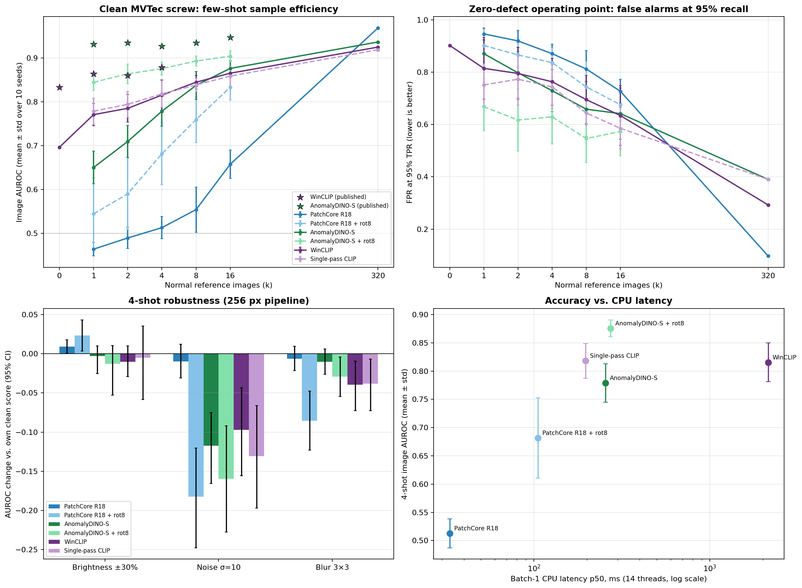
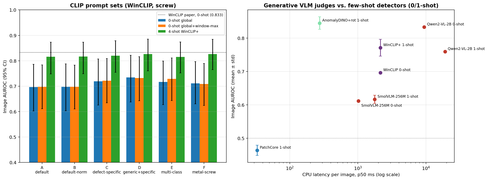

# Foundation models and vision-language models for few-shot defect detection

**In short:** a factory starting a new inspection line usually has only a handful of photos of good parts. I tested how
well modern "foundation" vision models (models pre-trained on huge image collections) can spot defective screws with
**0 to 16 example images**. I compared them against a standard industrial method, PatchCore, and also measured how
fast each one runs on an ordinary CPU. A second part tests whether better text prompts or a chat-style vision-language
model (asked "is this screw defective?") can replace the example images.

Code: [`notebooks/09_foundation_models_fewshot.py`](../../notebooks/09_foundation_models_fewshot.py) (detectors),
[`notebooks/10_vlm_prompts_and_judges.py`](../../notebooks/10_vlm_prompts_and_judges.py) (prompts and VLM judges)

## Key findings

| # | Finding | Evidence |
|:-:|:--|:--|
| 1 | **Foundation models work from the first image.** With only 1 good example, the best model (AnomalyDINO) separates good and defective screws with 0.84 AUROC. PatchCore scores 0.46, which is no better than guessing. | Table A |
| 2 | **I found a cause of PatchCore's failure and tested it.** Screws are photographed at random angles, so a few examples don't cover every orientation. Adding rotated copies of the examples raised PatchCore's 16-image score from 0.66 to 0.83. | Table B |
| 3 | **With plenty of data, the classic method still wins.** Given all 320 training images, PatchCore reaches 0.97, beating every few-image model. Foundation models are a cold-start tool, not a replacement. | Table A |
| 4 | **I found and fixed a bug in the anomalib library's WinCLIP.** Its 365 window crops all produced the *same* embedding (an input-layout mismatch with the current OpenCLIP version), so the windows did nothing. After my 10-line fix, WinCLIP's zero-shot defect localization went from 0.59 to 0.91 pixel AUROC, matching the paper. | Table E, notes |
| 5 | **The windows help localization, not detection, and cost 11× the CPU time.** With the fix, windows improve the defect heatmaps (pixel AUROC 0.975 vs 0.958 at 16 images) but not the good/defective decision (no significant difference). A single-pass variant runs in 0.20 s instead of 2.15 s. | Tables B, D |
| 6 | **A 2B-parameter chat VLM, asked a yes/no question, beat zero-shot CLIP**: 0.83 vs 0.70 AUROC (significant), but only when its Yes/No *probability* is used as a score. Its literal answers are useless (it says "Yes" for 6% of defective screws), it takes 9.4 s per image, and showing it a good reference image made it *worse*. | Table F |
| 7 | **Better prompt wording did not significantly help.** Six prompt sets for CLIP; the best gained +0.04 at 0-shot (not significant). Naming specific defects in the prompts badly hurt localization. | Table G |
| 8 | **Camera noise hurts every model; lighting changes don't.** Mild sensor noise cut accuracy by 0.10–0.18 for all models. A ±30% brightness shift had no significant effect. | Table C |

**How to read the numbers:** AUROC measures how well a model ranks defective parts above good ones. 1.0 is perfect
and 0.5 is a coin flip. "± x" is the variation across 10 different random picks of the example images. A result is
called **significant** only when its 95% confidence interval excludes zero.

## Why this matters for industrial inspection

- **Faster line setup.** Usable detection from 1–4 images means inspection can start before a large dataset of good parts exists.
- **Verify your libraries.** A silent bug in a widely used library made one model's localization look broken. Checking intermediate outputs (are window embeddings actually different?) caught it.
- **Know your operating limits.** The noise sensitivity tells you that sensor gain and lighting design matter more than small brightness drifts.
- **Cost-aware deployment.** PatchCore runs at 33 ms per image on CPU, AnomalyDINO at 255 ms, WinCLIP at 2.1 s and a 2B chat VLM at 9.4 s. Chat VLMs are far too slow for in-line inspection on a CPU, and their yes/no answers need calibration before use.

## Skills demonstrated

- **Experimental design:** every model sees exactly the same example images; 10 random draws per setting; paired statistical tests; ablations designed to test specific hypotheses (rotation, window crops, prompt wording, in-context reference).
- **Debugging and honest benchmarking:** traced a gap vs. the paper to a library bug, fixed it, kept the buggy numbers for reference; comparison against published numbers; claims that didn't survive testing were dropped.
- **Engineering:** encoded each image once and reused the result for all ~1,000 evaluations; a self-check that verifies cached results match the library's own output; latency measured with fixed thread counts and warm-up runs; VLM scoring from next-token log-probabilities in a single forward pass (no text generation).
- **Tools:** PyTorch, anomalib, DINOv2, OpenCLIP, Hugging Face Transformers (Qwen2-VL, SmolVLM), scikit-learn, pandas, matplotlib.

---

## Detailed results

Dataset: MVTec AD `screw` test set, 160 images (41 good, 119 defective). For each number of examples k ≤ 16, results
are averaged over 10 random draws, and every model sees the same draws. The full-data setting (k = 320) is run once.

### Models compared

| Name in tables | What it is |
|:--|:--|
| PatchCore R18 | Standard industrial baseline: compares image patches to a memory of normal patches (ResNet-18 features). |
| PatchCore R18 + rot8 | Same, with each example also stored at 7 extra rotations (45° to 315°). |
| AnomalyDINO-S | Same patch-matching idea, using DINOv2 features (a self-supervised foundation model), with background masking, 448 px input. |
| AnomalyDINO-S + rot8 | Same, with rotated examples, which is the original paper's recipe. |
| WinCLIP | Image-language model (CLIP). Compares the image and 365 window crops to text prompts such as "a photo of a damaged screw". At k ≥ 1 it also compares against the example images. anomalib implementation with my bug fix. |
| Single-pass CLIP | My simplified WinCLIP: one network pass per image, no window crops. |
| Qwen2-VL-2B / SmolVLM-256M | Chat-style vision-language models asked "Is this screw defective? Answer Yes or No." Score = log P(Yes) − log P(No). |

### Table A: Accuracy vs. number of example images (image AUROC, mean ± std)

| Model | 0 | 1 | 2 | 4 | 8 | 16 | 320 (all) |
|:--|:-:|:-:|:-:|:-:|:-:|:-:|:-:|
| PatchCore R18 | – | 0.46 ± .02 | 0.49 ± .02 | 0.51 ± .03 | 0.55 ± .05 | 0.66 ± .03 | **0.97** |
| PatchCore R18 + rot8 | – | 0.54 ± .08 | 0.59 ± .08 | 0.68 ± .07 | 0.76 ± .05 | 0.83 ± .03 | – |
| AnomalyDINO-S | – | 0.65 ± .04 | 0.71 ± .04 | 0.78 ± .03 | 0.84 ± .03 | 0.88 ± .02 | 0.94 |
| AnomalyDINO-S + rot8 | – | **0.84 ± .02** | **0.86 ± .02** | **0.88 ± .02** | **0.89 ± .01** | **0.90 ± .01** | – |
| WinCLIP | 0.70 | 0.77 ± .03 | 0.79 ± .03 | 0.82 ± .03 | 0.84 ± .02 | 0.87 ± .01 | 0.93 |
| Single-pass CLIP | – | 0.78 ± .03 | 0.79 ± .03 | 0.82 ± .03 | 0.84 ± .02 | 0.86 ± .02 | 0.92 |

`fewshot_summary.csv` also has the false-alarm rate at 95% and 99% detection (the operating points that matter for
zero-defect inspection) and pixel-level localization AUROC.

### Table B: Head-to-head tests (difference in AUROC, with 95% confidence interval)

| Comparison | Difference | 95% CI | Significant? |
|:--|:-:|:-:|:-:|
| Rotated examples help PatchCore (k=4) | +0.17 | [+0.12, +0.22] | Yes |
| Rotated examples help PatchCore (k=16) | +0.18 | [+0.14, +0.22] | Yes |
| Rotated examples help AnomalyDINO (k=1) | +0.19 | [+0.15, +0.24] | Yes |
| Single-pass CLIP vs. WinCLIP (k=1 / 4 / 16) | +0.01 / +0.00 / −0.01 | all include 0 | No difference |
| WinCLIP with 0 images vs. PatchCore with 16 | +0.04 | [−0.06, +0.14] | **No** |
| Best 16-image model vs. PatchCore with all 320 | −0.06 | [−0.13, −0.01] | Yes: full-data PatchCore wins |

Localization (pixel AUROC, k = 1 / 4 / 16): WinCLIP 0.959 / 0.968 / 0.975, Single-pass CLIP 0.933 / 0.949 / 0.958.

### Table C: Robustness to camera changes (4 example images; change vs. each model's own clean score)

| Model | Brightness ±30% | Noise σ=10 | Blur 3×3 |
|:--|:-:|:-:|:-:|
| PatchCore R18 + rot8 | +0.02 | **−0.18** | **−0.09** |
| AnomalyDINO-S + rot8 | −0.01 | **−0.16** | **−0.03** |
| WinCLIP | −0.01 | **−0.10** | **−0.04** |
| Single-pass CLIP | −0.01 | **−0.13** | **−0.04** |

Bold means the drop is significant. The rotation-free variants are in `robustness_summary.csv`. Plain PatchCore is
left out of this table: it is near chance even on clean images, so its robustness numbers carry no information.

### Table D: Speed on CPU (one image at a time, 4 example images, including pre-processing)

| Model | Input size | 4 CPU threads | 14 CPU threads |
|:--|:-:|:-:|:-:|
| PatchCore R18 | 256 px | 66 ms | 33 ms |
| PatchCore R18 + rot8 | 256 px | 209 ms | 106 ms |
| AnomalyDINO-S | 448 px | 551 ms | 255 ms |
| AnomalyDINO-S + rot8 | 448 px | 587 ms | 273 ms |
| Single-pass CLIP | 240 px | 370 ms | 196 ms |
| WinCLIP | 240 px | 4,074 ms | 2,147 ms |
| SmolVLM-256M judge (0-shot / 1-shot) | 448 px | – | 1,021 / 1,766 ms |
| Qwen2-VL-2B judge (0-shot / 1-shot) | 448 px | – | 9,417 / 19,042 ms |

Detectors: each model timed separately on an otherwise idle machine, after warm-up runs, median of 50 runs (30 for
Single-pass CLIP, 10 for WinCLIP). VLMs: median model forward time over all 160 test images during the accuracy run
(excludes pre-processing).

### Table E: Comparison with published results (image AUROC on screw)

| Method | Examples | My result | Paper |
|:--|:-:|:-:|:-:|
| WinCLIP | 0 | 0.70 | 0.83 |
| WinCLIP | 1 | 0.77 | 0.86 |
| WinCLIP | 4 | 0.82 | 0.88 |
| WinCLIP, 0-shot localization (pixel AUROC) | 0 | 0.91 (0.59 before fix) | 0.90 |
| AnomalyDINO-S (+rot) | 1 | 0.84 | 0.93 |
| AnomalyDINO-S (+rot) | 4 | 0.88 | 0.93 |
| AnomalyDINO-S (+rot) | 16 | 0.90 | 0.95 |

Sources: WinCLIP (Jeong et al., CVPR 2023), Table 10; AnomalyDINO (Damm et al., WACV 2025), Table 6.

---

## Part 2: Can language replace the example images?

Code: [`notebooks/10_vlm_prompts_and_judges.py`](../../notebooks/10_vlm_prompts_and_judges.py), outputs in
[`results/vlm/`](../vlm/).

### Table F: Chat VLMs as yes/no defect judges (image AUROC)

| Judge | Setting | AUROC | vs. comparable detector | Says "Yes" to defective / good | Latency |
|:--|:--|:-:|:--|:-:|:-:|
| Qwen2-VL-2B | 0-shot | **0.83** | **+0.14 vs WinCLIP 0-shot** [+0.01, +0.25] | 6% / 0% | 9.4 s |
| Qwen2-VL-2B | 1 good reference shown | 0.76 | −0.03 vs WinCLIP 1-shot, −0.06 vs AnomalyDINO 1-shot (n.s.) | 3% / 0% | 19.0 s |
| SmolVLM-256M | 0-shot | 0.61 | −0.09 vs WinCLIP 0-shot (n.s.) | 4% / 0% | 1.0 s |
| SmolVLM-256M | 1 good reference shown (3 draws) | 0.62 ± .01 | **−0.23 vs AnomalyDINO 1-shot** [−0.34, −0.12] | 94% / 94% | 1.8 s |

- **The ranking is real, the answers aren't.** Qwen's probability of "Yes" rises for defective screws, which gives a
  useful score, but it almost never actually answers "Yes". A deployment would need a calibrated threshold, which needs
  labelled defective examples, the very thing a cold-start line lacks.
- **A reference image hurt.** Showing Qwen a good screw next to the test screw lowered AUROC from 0.83 to 0.76; the
  small model just answered "Yes" to everything. Neither VLM made good use of the reference here.
- **Cost:** Qwen is ~34× slower than AnomalyDINO + rot8 (9.4 s vs. 0.27 s at 14 threads) for similar accuracy, though Qwen needs no example image.

### Table G: CLIP prompt wording (WinCLIP, image AUROC; difference vs. the default prompts)

| Prompt set | 0-shot | 0-shot localization (pixel AUROC) | 4-shot |
|:--|:-:|:-:|:-:|
| A: anomalib default | 0.70 | 0.91 | 0.82 |
| B: default, normalised averaging | 0.70 (+0.00) | 0.91 | 0.82 (+0.00) |
| C: named screw defects ("damaged thread", "bent tip"...) | 0.72 (+0.02, n.s.) | **0.48** | 0.82 (+0.00, n.s.) |
| D: generic + named defects | 0.73 (+0.04, n.s.) | 0.63 | 0.83 (+0.01, n.s.) |
| E: one text class per defect type | 0.72 (+0.02, n.s.) | **0.37** | 0.82 (+0.00, n.s.) |
| F: "metal screw" | 0.71 (+0.01, n.s.) | 0.87 | 0.83 (+0.01, n.s.) |

All six prompt sets were fixed before seeing results and all are reported. Named-defect prompts use knowledge of the
MVTec defect categories, so they are "informed" prompts, and even so they did not help significantly. They also broke
localization. A likely but untested explanation is that defect names match normal screw parts, since a thread is always present.

## Limitations and next steps

- **AnomalyDINO gap (0.05–0.09 below the paper).** I used 448 px images; the paper's table uses 672 px. The paper
  also doesn't state which rotation angles it used. Next step: rerun at 672 px.
- **WinCLIP image-level gap (0.06–0.13 below the paper).** The library bug explained the localization gap but not the
  detection gap. Remaining suspects: prompt ensemble and score aggregation details in anomalib vs. the paper.
- **VLM judges:** Qwen2-VL was run with one reference draw (CPU cost: ~1.5 h for 320 forward passes), so its 1-shot
  result has no spread across draws. One question wording was used; VLMs are known to be prompt-sensitive.
- **One product type.** Only screws were tested; other MVTec categories may behave differently.
- **Confidence intervals** cover uncertainty from the limited test set. Uncertainty from which example images were
  picked is shown separately as the ± spread.

Implementation notes

- **The WinCLIP bug.** anomalib's `WinClipModel._get_window_embeddings` permutes window tokens to sequence-first
  (`NLD → LND`) before calling the OpenCLIP transformer, but the installed OpenCLIP (3.3.0) builds its transformer batch-first. The
  attention then mixes tokens across windows, so all window embeddings came out identical (std 0 across windows).
  Notebook 09 patches the method to keep the batch-first layout; the patched full-image "window" reproduces the
  global embedding exactly (cosine 1.0000). Observed with anomalib 2.7.0 and open_clip_torch 3.3.0.
  [`scripts/repro_winclip_window_bug.py`](../../scripts/repro_winclip_window_bug.py) reproduces it on a random image and
  contains the fix. `--unpatched-winclip` reruns the original, and the old numbers are kept in
  `winclip_unpatched_reference.csv`.
- Every model is scored by caching each image's features once, then computing nearest-neighbour distances against any
  subset of example images. `--selfcheck` confirms the cached scores match anomalib's own output (AnomalyDINO exactly,
  WinCLIP to ~1e-5).
- The k-shot example set for draw *s* is the first k images of a fixed random permutation (seed s + 100) of the 320
  training images, so smaller sets are nested inside larger ones. The VLM 1-shot reference for draw *s* is the first of
  those images, the same one the 1-shot detectors use, so the VLM-vs-detector tests are paired.
- VLM scores come from one forward pass: log P(Yes) − log P(No) over the next token ("Yes"/" Yes", "No"/" No"). Yes+No
  hold 74–99% of the probability mass, so the models are answering the question. Qwen2-VL images are resized to 256
  visual tokens (~448 px); SmolVLM image splitting is off. fp32 on CPU, 14 threads.
- Pixel AUROC is computed on a 128×128 grid; a cell counts as defective if any ground-truth pixel inside it is.
- Robustness tests apply the degradations at 256 px (as in the earlier notebooks) for all models. AnomalyDINO
  upsamples those images to 448 px.
- Single-pass CLIP comes from the same forward pass as WinCLIP, so the comparison isolates the effect of the window
  crops. Both CLIP variants have a 117 M-parameter vision encoder.

